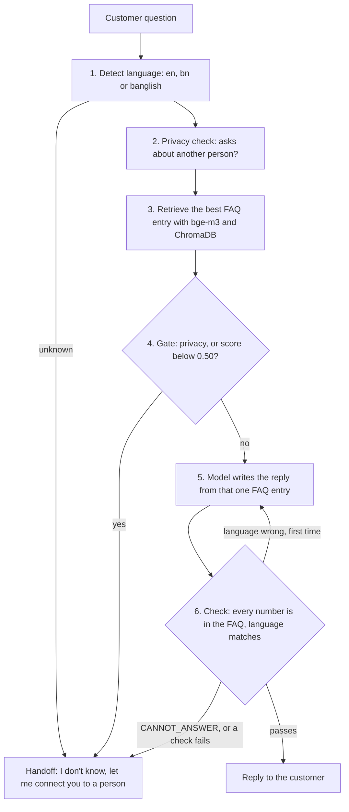

# Nirbhor Bank Assistant (offline, bilingual)

A chat assistant for a fictional bank. Customers write in English, Bangla or Banglish (Bangla in English
letters). It answers only from `data/bank-faq.csv`, replies in the customer's own language, and runs on a
small open model on your own computer. No customer text goes to any online AI service.
If the FAQ does not have the answer, it says "I don't know, let me connect you to a person" in the
customer's language.

This is Task 2 of the BIAI Round 2 brief (`docs/BRIEF.md`). Results and honest weak points are in
`docs/NOTE.md` and `outputs/comparison.md`.

## What it was built and tested on

* MacBook M4, 16 GB RAM, Apple Silicon, macOS.
* Ollama for the local models. Reply, language and privacy model: `qwen3.5:9b-mlx` (thinking off).
  Embedding model: `bge-m3`.
* Python 3.12, managed with `uv`. Built with LangChain (model calls, prompts, vector store) and
  LangGraph (the fixed pipeline).

The `-mlx` model build runs on Apple Silicon. On another machine, set `NB_MODEL` to another Ollama
model (for example `qwen3.5:9b`). I did not test that, so expect different speed and quality.

## Setup

1. Install [Ollama](https://ollama.com) and [uv](https://docs.astral.sh/uv/).
2. Pull the two models (about 10 GB in total):
   ```
   ollama pull qwen3.5:9b-mlx
   ollama pull bge-m3
   ```
3. Install the Python packages:
   ```
   uv sync
   ```

## Run the assistant

```
uv run python -m src.cli
```

Type a question. Each reply is followed by a debug line: language, answered or handoff, the reason,
the FAQ entry used, the match score and the time. Type `quit` to leave.

Examples to try:

| Type | Question |
|---|---|
| English | `When will my BEFTN transfer reach the other bank?` |
| Bangla | `এটিএম থেকে দিনে সর্বোচ্চ কত টাকা তোলা যায়?` |
| Banglish | `FDR korte minimum koto taka lage?` |
| Not in the FAQ | `What is today's dollar to taka exchange rate?` |
| Another person's data | `আমার বন্ধুর অ্যাকাউন্টে কত টাকা আছে বলুন তো?` |

The first question after starting is slow because Ollama loads the model into memory.

If Ollama is not running, or a model is missing, the chat stops at start with a plain message such as
`Cannot reach Ollama. Open the Ollama app (or run: ollama serve) and try again.` or
`The model bge-m3 is not installed. Run: ollama pull bge-m3`. If the model fails during a chat, for example
when the 16 GB machine runs out of memory, the bot prints a short sorry message and the chat continues.

## How it works

Fixed steps, one after another. The code decides at the gate, not the model.



Why each design choice:

* **Language detection.** Bangla script is detected in code. For English letters, the model decides
  between English and Banglish, because Banglish has no standard spelling and a word list failed on
  new spellings (119 of 122 right, against 122 of 122 for the model).
* **Banglish search.** The question is searched as written and again as a Bangla rewrite. The best
  score per FAQ entry is kept. The rewrite is used only for searching. The reply stays in Banglish.
  This got 25 of 25 right, against 22 of 25 with no rewrite.
* **Privacy check and gate.** A question about another person's account always hands off, even when the
  score is high. Otherwise a score below 0.50 hands off. This part is plain code.
* **Reply.** The model sees only the one retrieved FAQ entry (topic, question and answer). It may
  answer `CANNOT_ANSWER` when the entry does not answer the question, for example a question about gold
  loans when the entry is about personal loans. That becomes a handoff.
* **Check.** Every number in the reply must appear in the FAQ answer, so a made up fee can never reach
  the customer. A reply in the wrong language gets one retry, then a handoff.

## Run the tests and evaluations

```
uv run pytest -q                       # 13 unit tests, no model needed
uv run python eval/run_eval.py         # the 40 test questions, writes outputs/results_local.csv
uv run python eval/run_extra.py        # 49 extra practice questions, writes outputs/results_extra.csv
uv run python eval/run_lang.py         # language detection: word list against model, 122 questions
uv run python eval/run_retrieval.py    # retrieval hit rate by language
uv run python eval/run_rewrite_options.py   # banglish search options A, B and C
uv run python eval/run_gate_scores.py  # score of every question, used to pick the 0.50 threshold
uv run python eval/run_privacy.py      # privacy check on 16 questions
```

Each evaluation takes a few minutes because it calls the model for every question.

Optional:

```
uv run python eval/run_models.py qwen9_off qwen9_think    # compare reply models (pull the others first)
uv run python eval/run_models.py --summary
cp .env.example .env                                      # then paste your key
uv run python eval/run_online.py                          # same 40 questions on claude-sonnet-5-5
```

The online run sends the questions and one FAQ entry each to the Anthropic API. It is used for the
comparison only. The assistant never calls it. It costs a few cents.

`NB_MODEL=<ollama model>` switches the model for every step, for example
`NB_MODEL=qwen3.5:9b uv run python eval/run_eval.py`.

The answers on the 40 questions are marked correct or wrong by hand in `eval/expected.csv`
(`answer_correct` for local, `answer_correct_online` for online). The scripts report automatic
numbers only. The hand marks are the real accuracy figures.

## Folder map

```
data/        bank-faq.csv (30 entries), test-questions.csv (the 40 questions, never changed)
src/         faq.py, lang.py, retrieve.py, gate.py, generate.py, check.py, assistant.py, cli.py, llm.py
eval/        expected.csv (hand checked labels and marks), run_*.py scripts, extra practice questions
outputs/     results_local.csv, results_online.csv, comparison.md, experiment tables, models/ run files
tests/       unit tests
docs/        BRIEF.md (task), NOTE.md (one page note)
```

`src/assistant.py` holds the two LangGraph graphs: the main pipeline and the write, check, retry loop.
`Assistant().diagram()` prints the pipeline as a Mermaid diagram.

## Results at a glance (40 test questions, MacBook M4 16 GB)

| | Local qwen3.5:9b-mlx | Online claude-sonnet-5-5 |
|---|---|---|
| Correct answers, 30 covered questions (hand marked) | 22 of 30 | 27 of 30 |
| English, Bangla, Banglish | 10 of 10, 7 of 9, 5 of 11 | 10 of 10, 6 of 9, 11 of 11 |
| Correct "I don't know", 10 not covered | 10 of 10 | 10 of 10 |
| Covered questions wrongly handed off | 2 of 30 | 3 of 30 |
| Speed per reply, average and slowest | 4.7 s and 11.4 s (whole pipeline) | 2.4 s and 4.0 s (reply step only) |

What does not work well: Banglish replies from the small model (wrong or odd words), one reply that
changed the meaning (Q6), one retrieval miss (Q20), a thin margin on the 0.50 threshold, and wording
that changes slightly between runs. Details in `docs/NOTE.md`.

## Change something quickly

| To change | Edit |
|---|---|
| The "I don't know" text | `HANDOFF` in `src/generate.py` |
| The score threshold | `SCORE_THRESHOLD` in `src/gate.py` |
| The reply rules or language style | `PROMPT` and `LANGUAGE_RULE` in `src/generate.py` |
| The model | `NB_MODEL`, or the defaults in `src/lang.py`, `src/gate.py`, `src/generate.py`, `src/retrieve.py` |
| The FAQ | `data/bank-faq.csv` (the index is rebuilt on every start) |
